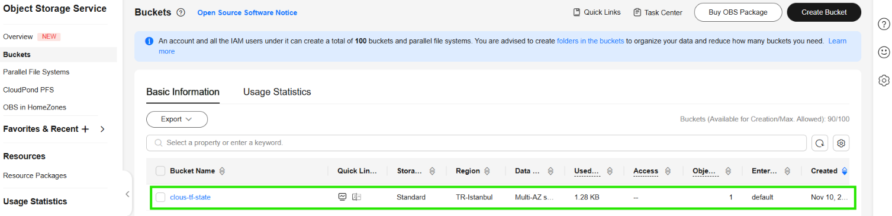
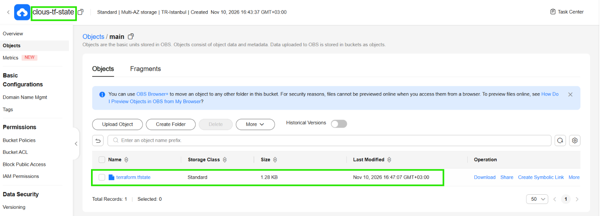
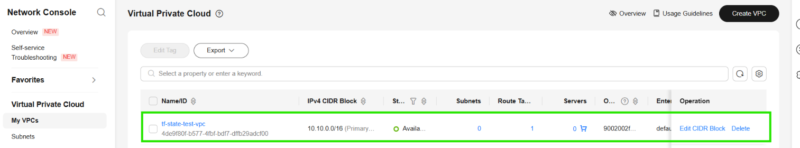

# Huawei Cloud OBS'de Terraform State (TR-Istanbul)

Terraform state dosyasını Huawei Cloud **OBS (Object Storage Service)** üzerinde, **TR-Istanbul (`tr-west-1`)** bölgesinde tutan kurulum.

OBS S3 API uyumlu olduğu için ayrı bir backend gerekmez. Terraform'un yerleşik `s3` backend'i, OBS endpoint'i ve birkaç `skip_*` ayarıyla doğrudan OBS'ye yazar ([Huawei Cloud resmi dokümanı](https://support.huaweicloud.com/basics-terraform/terraform_0021.html)).

| Bilgi | Değer |
|---|---|
| Bölge | TR-Istanbul (`tr-west-1`) |
| OBS endpoint | `https://obs.tr-west-1.myhuaweicloud.com` |
| Terraform | `>= 1.6.3` (1.17.0 ile test edildi) |
| huaweicloud provider | `>= 1.60.0` (1.100.0 ile test edildi) |

## Proje yapısı

```
.
├── env.ps1                  # Windows: ortam değişkenlerini yükler, main/backend.hcl üretir
├── env.sh                   # Linux / macOS / WSL / CI karşılığı
├── secrets.ps1.example      # AK/SK şablonu (Windows)
├── secrets.sh.example       # AK/SK şablonu (bash)
├── bootstrap/               # state bucket'ını BİR KEZ oluşturur (yerel state)
│   ├── main.tf
│   └── .terraform.lock.hcl
└── main/                    # asıl altyapı (state OBS'de)
    ├── versions.tf
    ├── backend.tf           # s3 backend + OBS endpoint
    ├── backend.hcl.example
    ├── provider.tf
    ├── main.tf              # örnek: test VPC'si
    └── .terraform.lock.hcl
```

- **`bootstrap/`**: State bucket'ını oluşturur. Henüz state'i koyacak bucket olmadığı için kendi state'ini yerelde tutar. Bucket private, versiyonlu, SSE-OBS ile şifreli ve `prevent_destroy` ile korumalıdır.
- **`main/`**: Asıl altyapı. State'i `<bucket>/main/terraform.tfstate` yolunda tutar.
- **AK/SK hiçbir `.tf` dosyasında yer almaz.** `secrets.ps1` ve `secrets.sh` dosyaları `.gitignore`'dadır.
- **`.terraform.lock.hcl`** provider sürümünü ve paket hash'lerini sabitler. Bilerek repodadır.

## Ön koşullar

1. **Terraform 1.6.3+**
   - Windows: `winget install Hashicorp.Terraform` (kurulumdan sonra terminali yeniden açın)
   - macOS: `brew install terraform`
2. **IAM kullanıcısı (programatik erişim)**: Konsol → IAM
   - **User Groups → Create User Group**: `terraform-ops`. Gruba **OBS Administrator** ve **VPC FullAccess** politikalarını atayın.
   - **Users → Create User**: `terraform-bot`, *Access Type* = **Programmatic access**, *Credential Type* = **Access key**, grup = `terraform-ops`.
3. **AK/SK**: IAM → Users → `terraform-bot` → **Security Settings → Access Keys → Create Access Key**. İnen `credentials.csv` dosyasını güvenli bir yerde saklayın.

> huaweicloud provider **`HW_*`**, S3 backend ise **`AWS_*`** değişkenlerini okur. `env.ps1` ve `env.sh` ikisini de aynı AK/SK'dan üretir; ayrıca OBS'nin ihtiyaç duyduğu checksum ayarlarını yapar.

## Kurulum: Windows (PowerShell)

### 1. Repoyu alın ve kimlik bilgilerini girin

```powershell
git clone https://github.com/yigitfurkann/hwc-obs-state-terraform.git
cd hwc-obs-state-terraform
Copy-Item secrets.ps1.example secrets.ps1
code secrets.ps1     # AK, SK ve benzersiz bir bucket adı yazıp kaydedin
```

### 2. Ortamı yükleyin (her yeni terminalde)

```powershell
Set-ExecutionPolicy -Scope Process -ExecutionPolicy Bypass
. .\env.ps1
```

```
Ortam hazır. Bölge: tr-west-1  Bucket: <bucket-adınız>
```

### 3. State bucket'ını oluşturun (bir kez)

```powershell
cd bootstrap
terraform init
terraform plan
terraform apply      # onay için: yes
cd ..
```

```
huaweicloud_obs_bucket.tf_state: Creation complete after 3s [id=<bucket-adınız>]

Apply complete! Resources: 1 added, 0 changed, 0 destroyed.
```



> Oluşan `bootstrap/terraform.tfstate` dosyası bucket'ın kendi state'idir; güvenli bir yerde saklayın.
> Bucket'ı konsoldan açmayı tercih ederseniz bu adımı atlayın; **Versioning**'i açın, **WORM**'u kapalı bırakın.

### 4. Ana projeyi OBS backend'ine bağlayın

PowerShell'de argüman tırnak içinde yazılmalıdır:

```powershell
cd main
terraform init "-backend-config=backend.hcl"
```

```
Successfully configured the backend "s3"! Terraform will automatically
use this backend unless the backend configuration changes.
```

### 5. Plan ve apply

```powershell
terraform plan       # Plan: 1 to add
terraform apply      # onay için: yes
```

## Kurulum: Linux / macOS / WSL (bash)

```bash
git clone https://github.com/yigitfurkann/hwc-obs-state-terraform.git
cd hwc-obs-state-terraform
cp secrets.sh.example secrets.sh && vi secrets.sh
source ./env.sh

cd bootstrap && terraform init && terraform apply && cd ..
cd main && terraform init -backend-config=backend.hcl && terraform apply
```

**CI/CD**: `secrets.sh` yerine `HW_ACCESS_KEY`, `HW_SECRET_KEY` ve `TF_STATE_BUCKET` değerlerini pipeline secret'ı olarak tanımlayıp `source ./env.sh` çalıştırın.

## Doğrulama

```powershell
terraform state list
terraform plan
```

```
huaweicloud_vpc.test

No changes. Your infrastructure matches the configuration.
```

State dosyası OBS'de `main/terraform.tfstate` yolunda:



Terraform ile oluşturulan test VPC'si:



## Kendi altyapınızı eklemek

`main/main.tf` içindeki test VPC'sini silip kendi kaynaklarınızı `main/` altına `.tf` dosyaları olarak ekleyin. Farklı proje veya ortamlar için `backend.hcl` içindeki `key` değerini değiştirin (ör. `prod/network/terraform.tfstate`).

## Temizlik

```powershell
cd main
terraform destroy
```

Bucket'ı da tamamen kaldırmak için:

1. Konsol → OBS → bucket → **Objects** → **Historical Versions** anahtarını açın ve tüm nesneleri, tüm sürümleriyle birlikte silin.
2. `bootstrap/main.tf` içindeki `lifecycle { prevent_destroy = true }` bloğunu silin.
3. `cd bootstrap` ve ardından `terraform destroy`.

## Notlar

- **State kilitleme**: OBS'de DynamoDB karşılığı yoktur ve bu kurulum kilitleme yapmaz. Aynı state üzerinde eşzamanlı `apply` çalışmasını CI/CD tarafında engelleyin.
- **Terraform < 1.6**: `endpoints = { s3 = ... }` yerine `endpoint = "..."` kullanın ve `skip_requesting_account_id` ile `skip_s3_checksum` satırlarını kaldırın.

## Kaynaklar

- [Huawei Cloud: Terraform Backend](https://support.huaweicloud.com/basics-terraform/terraform_0021.html)
- [huaweicloud Terraform provider](https://registry.terraform.io/providers/huaweicloud/huaweicloud/latest/docs)
- [Terraform: S3 backend](https://developer.hashicorp.com/terraform/language/backend/s3)
